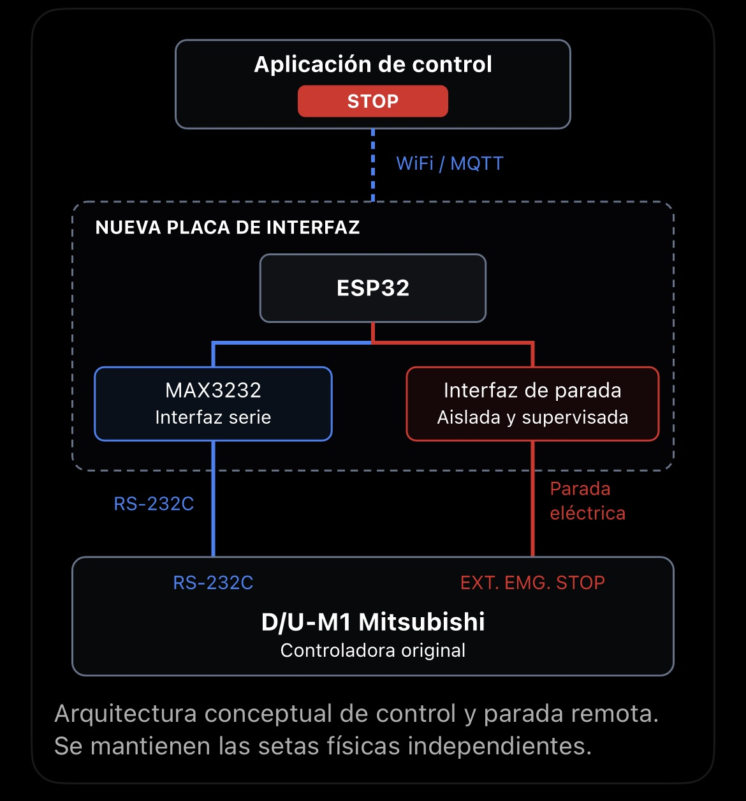
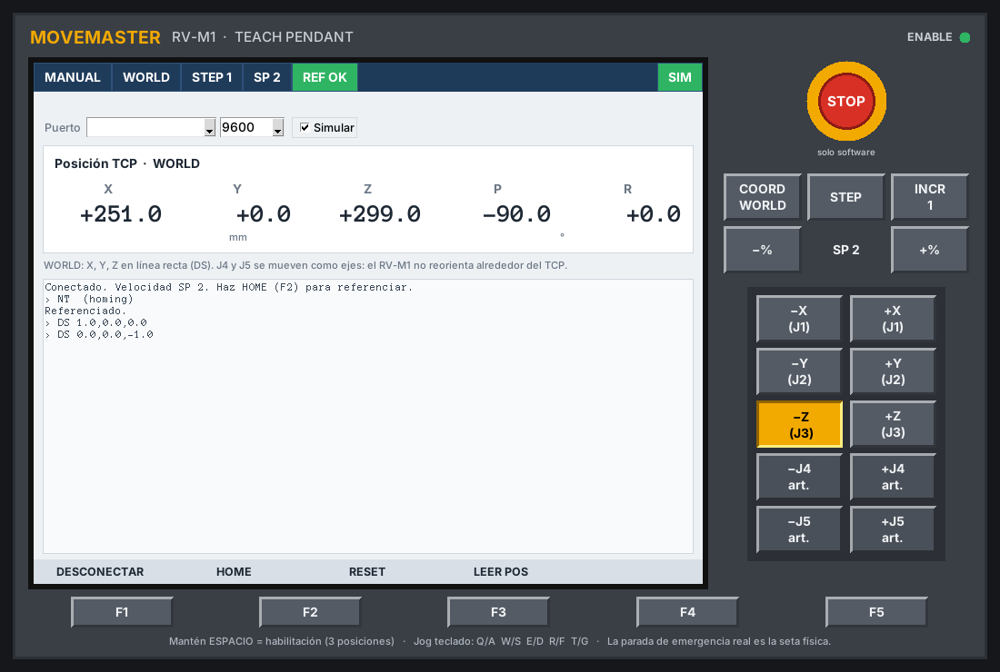

# Propuesta de Proyecto Final de Grado

## Recuperación y control remoto IoT de un brazo robótico Mitsubishi Movemaster RV-M1 mediante Python y MQTT

Modernización de un brazo robótico Mitsubishi **Movemaster EX RV-M1** (5 grados de libertad, servomotores DC con encoders incrementales, controladora D/U-M1 con interfaces RS-232C y Centronics): reparación, control desde Python, teach pendant de software y puente IoT a MQTT.

## Tareas

Casilla marcada = hecha y verificada; sin marcar = pendiente. Se actualiza al cerrar cada tarea (`- [x]`).

- [x] **1.** **Reparar el error del homing** (error de modo I) hasta que NT termine sin fallos.
- [ ] **2.** **Probar la teaching box original (T/B-M1)** en sus dos modos de movimiento: articular y cartesiano (XYZ).
- [ ] **3.** **Probar desde el PC por RS-232** con `rvm1_control.py`: comandos, lectura de posición (WH) y de errores (ER).
- [ ] **4.** **Probar el pendant de software** (`rvm1_pendant.py`) con el robot real, conectado directamente al PC.
- [ ] **5.** **Desarrollar la placa de interfaz:** implementar una pasarela basada en ESP32 con comunicación WiFi/MQTT, conversor de niveles RS-232C (MAX3232) y una interfaz de parada eléctrica aislada y supervisada, conectada a la entrada `EXT. EMG. STOP` de la controladora D/U-M1, cuya disponibilidad y comportamiento deberán verificarse en la unidad real. **Requisito indispensable de seguridad:** la placa solo permite el movimiento mientras recibe el **latido** de la aplicación; si falta, abre el circuito de parada por sí misma, sin depender del broker, con fallo seguro en hardware y rearme manual (contrato MQTT, sección 5). No es una función certificada y no sustituye a las setas físicas.

   

   *Arquitectura conceptual de la placa: canal de control RS-232C y canal de solicitud de parada eléctrica independiente del intérprete serie. Se mantienen las setas físicas independientes. El STOP remoto por WiFi/MQTT es complementario y no constituye por sí solo una función de seguridad certificada.*

- [x] **6.** **Definir los topics MQTT:** uno para enviar comandos y otros para publicar posición, error y estado, más el topic de **latido** y los estados de seguridad (`permiso`, `parada`, `circuito_parada`). *(contrato v0.5, borrador)*
- [ ] **7.** **Pasar el pendant a MQTT,** para que hable con la placa en vez de con el puerto serie. *(hecho en el pendant web del gemelo; falta con la placa real)*
- [ ] **8.** **Aprendizaje de puntos:** grabar posiciones y reproducir secuencias. *(hecho en el gemelo: puntos HE y programas; falta con el robot real)*
- [ ] **9.** **Coger y dejar un objeto** con la pinza. *(hecho en el gemelo; falta con el robot real)*
- [ ] **10.** **Validar la parada segura:** medir la latencia del latido y de `stop`, el tiempo de frenado del robot y el tiempo hasta abrir el circuito ante fallos inyectados (WiFi, broker, aplicación, alimentación de la placa).
- [ ] **11.** **Gemelo digital** con los mismos comandos y topics MQTT que el robot real, validado frente a él y usado para formar al alumnado antes de usar el brazo. *(gemelo hecho; falta validarlo frente al robot real)*

## Estructura del repositorio

```
Codigo/
  Gemelo/              Gemelo digital web (3D + teach pendant, contrato MQTT como rvm1/gemelo/<id>/); ver Codigo/Gemelo/README.md
  PCB_Interfaz/        Placa de interfaz ESP32 (esquemas, firmware y fabricación); ver su README
  Software_Control/
    rvm1_control.py    Control por RS-232C desde consola (jog articular y cartesiano, WH, ER...)
    rvm1_pendant.py    Teach pendant gráfico (Tkinter) con aspecto y manejo de pendant industrial
  Broker/              Servidor MQTT del aula (Mosquitto, usuarios y ACL) y web del gemelo; ver Codigo/Broker/README.md
Investigacion/
  Paper/               Artículo en LaTeX (main.tex, secciones/, build.sh) y PDF
  Estado_del_Arte/     Búsquedas, fichas, matriz, huecos y síntesis
  Referencias/         refs.bib: bibliografía verificada
  Revisiones/          Informes de revisión y verificación
  Experimentos/        Protocolos, datos crudos (inmutables) y analisis/ (scripts y figuras)
Docu/
  Propuesta_PFG_RV-M1.pdf   Esta propuesta en PDF
  contrato_mqtt.md / .pdf   Contrato MQTT (topics real/gemelo, comandos, ACK, estado, posición, latido)
  referencias.md            Manuales y documentación técnica del RV-M1
  arquitectura_control_parada_remota.jpg, pendant.png   Imágenes
  encargos/                 Encargos de trabajo para los agentes
```

## Uso rápido

Requisitos: Python 3.8+ y `pyserial` (`pip install pyserial`). Los dos scripts deben estar en la misma carpeta.

```bash
cd codigo
python rvm1_control.py --port COM3        # consola de comandos
python rvm1_pendant.py                    # teach pendant gráfico (marca "Simular" para probar sin robot)
```

En el pendant hay que **mantener pulsada la barra espaciadora** como dispositivo de habilitación; el jog se hace con las teclas de la derecha o con Q/A, W/S, E/D, R/F, T/G. El modo cartesiano (WORLD) solo se activa tras referenciar el robot (HOME).



## Trabajo con agentes (Claude Code)

El repositorio incluye un equipo de agentes para el artículo de investigación. Al clonarlo y abrirlo con Claude Code se cargan solos:

- `CLAUDE.md`: contexto del proyecto, flujo de trabajo y reglas (no inventar referencias ni datos, seguridad del robot, separación productor/revisor).
- `.claude/agents/`: `investigador`, `verificador-referencias`, `ingeniero`, `analista-experimentos`, `redactor` y `revisor`.
- `.claude/skills/`: 14 skills, cada agente carga solo las suyas.

Estado actual en `Investigacion/Estado_del_Arte/estado_del_arte.md`, `Investigacion/Estado_del_Arte/huecos.md` y `Investigacion/Revisiones/`.

```bash
git clone https://github.com/AlvarLegaz/modernizacion-robot-rv-m1
cd modernizacion-robot-rv-m1
claude    # y, por ejemplo: "continúa con la fase 4 del flujo de CLAUDE.md"
```

## Avisos

- La sintaxis de comandos y los parámetros serie (9600 baudios, 7 bits, paridad par, 2 de stop) están tomados del manual y **deben verificarse con la máquina** (interruptores SW2/SW3 de la controladora).
- El botón STOP del pendant es solo software: deja de enviar órdenes. **La parada de emergencia real es la seta física** de la controladora o de la teaching box.
